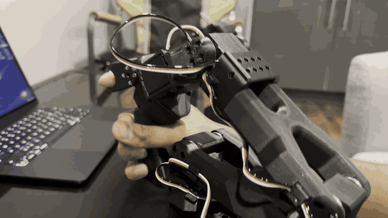

# Jitterbug

Jitterbug is a fixed rate leader/follower teleop layer for SO-101 arms, written from scratch in Rust. The more complete technical report and discovery is on the [blog](https://www.conjeevaram.net/jitterbug)!



## Results

### Timing / Lateness

The data below was collected over 80 interleaved 30 second runs at a 200 hz target against lerobot's teleop.

| | LeRobot | Jitterbug |
|---|---|---|
| rate, median over 80 runs | 195.3 hz | 200 hz |
| wake lateness p50 / p99 | 75 / 227 us | 5 / 8 us |
| ticks a full period or more late | 1 in 469,367 | 0 in 480,000 |

Obviously this looks pretty great, I'm really curious if this determinism actually benefits policies trained and deployed on the hardware, for example how do dropped ticks etc. affect performance? Will have to wait to find out... stay tuned [here](https://www.conjeevaram.net/manipulation-marathon)

### Lead compensation

Without help, the follower usually trails the leader by ~100ms depending on the joint. --lead=MS sets the goal MS ahead of the leader, using the leader's current vel. Below is some typical pick and place behaviour, compared with lead off vs 115ms lead:

| joint | follower lag, lead off | follower lag, lead 115 ms | change in leader to follower error | goal path vs leader path (1.0 = same) |
|---|---|---|---|---|
| 1 | 106 ms | 34 ms | -66% | 1.49 |
| 2 | 102 ms | 57 ms | -40% | 1.56 |
| 3 | 100 ms | 54 ms | -51% | 1.81 |
| 4 | 95 ms | 47 ms | -45% | 1.58 |
| 5 | 87 ms | 54 ms | -26% | 2.10 |

For clarity:
Lag = std(leader minus follower) / rms(leader speed). 
E2e error = rms(leader - follower)
Goal activity = mean |change in goal| / mean |change in leader|, so 1.0 means the goal moves exactly like the leader.

So the lead comp has a cost - anything the leader does that is not motion (sensor noise, hand shaking) is amplified by the lookahead, so the goal jitters (last column) and the follower chatters, more so at longer lookaheads. How much lookahead is acceptable is a tradeoff, lots more thoughts [here!](https://www.conjeevaram.net/jitterbug/#lead-compensation).

## Model and limits

fit.py fits a model for one joint using least squares:

```
goal -> deadband -> delay -> first order lag -> measured
```

| joint | deadband | delay | lag time constant | held out fit |
|---|---|---|---|---|
| 2 | 4 ticks | 40 ms | 75 ms | 73% |
| 3 | 3 ticks | 25 ms | 80 ms | 77% |

The model is what picked the 115 ms lookahead (which is in theory the optimum) and drives SimServo, a simulated follower in tests.rs. The model breaks above about 3 hz (because the servos simply dont respond to high frequencies), on step transients and at small amplitudes, and it's optimistic: it predicted ~ 39 ms of lag at 115 ms lead whereas real data showed ~ 55.

## Layout

```
src/
  main.rs              cli flags, opens both arms, runs the loop, writes to csv
  teleop.rs            run(), high level loop
  teleop/
    pacer.rs           absolute timing grid
    session.rs         tracks per run state and executes tasks for one tick
    command.rs         defining target pose from multiple sources, lead compensation
    tests.rs           mock servo, SimServo (fitted model), run level tests
  stimulus.rs          scripted chirp or step on one joint, for system identification
  safety.rs            clamp to joint limits, cap motion / tick
  servo.rs             bus operations as a trait, so tests can use a mock
  bus.rs               serial port and Feetech bus transactions
  protocol.rs          packet encode and decode
  rt.rs                timer slack, core pinning, SCHED_FIFO, cpu time (uses libc)
benchmark/
  lr_vs_jb.sh            interleaved lerobot vs jitterbug runs for data collection
  lerobot_instrumented.py   lerobot's teleop loop with some custom logging ^
sysid/
  fit.py               fits the servo model from stimulus runs
  lead_comp_test.py    compares lead settings from teleop runs
```

## Usage

```
cargo build --release
cargo test
./target/release/jitterbug /dev/ttyACM0 /dev/ttyACM1 6000 run.csv # check your own ports obviously
```

cargo test needs no hardware, it uses the mock servo in tests.rs. some optional flags:

```
./target/release/jitterbug /dev/ttyACM0 /dev/ttyACM1 6000 run.csv --pin=20 --lead=115
```

- `--hz=N` loop rate, default 200
- `--pin=CORE` pins the loop to a core of your choosing
- `--rt=PRIO` runs the loop as SCHED_FIFO (1 to 99) with memory locked, so regular tasks cant interrupt it. Probably best to use a modest priority like 50. It needs two capabilities, granted to the binary with `sudo setcap cap_sys_nice,cap_ipc_lock+ep ./target/release/jitterbug`. I believe you'll need to run that after every build unfortunately.
- `--lead=MS` aims the goal ahead of the leader by MS, using its speed over the last 10 samples
- `--max-speed=N` is a per tick motion cap in servo ticks / second, defaults to 2000 (10 ticks per tick at 200 hz)

Safety wise... we read joint limits from the servos at startup, three failed leader reads in a row abort the run, and torque is released on exit and on ctrlc.
